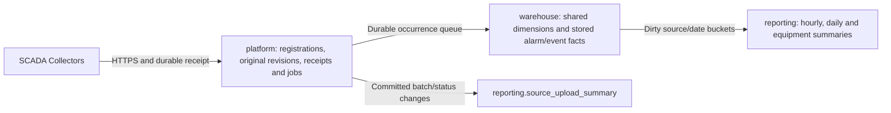

# Central Server analysis and security punchlist

## Implemented scope

The WSL/Docker manager adds **Alarm analysis** for recurring alarms, affected equipment and daily trends. Counts are calculated from saved records. The optional local model continues to suggest equipment names; it does not diagnose root causes or establish authoritative machine identity. Mapping approval is retired by [source-scoped processing](source-scoped-processing.md). Equipment review and AI settings now share Alarm analysis; the duplicate Identification page is removed. Viewing or refreshing never enables AI or calls a model.

| Requested item | Implementation |
| --- | --- |
| Standard warehouse structure | `0010` introduced reporting views; `0011_stored_warehouse` stores alarm/event facts and summaries; `0012` shares new-source storage; `0013_remove_source_copies` verifies and removes legacy duplicates; `0014` adds named occurrence views for project/source filtering. |
| Alarm issue analysis | Customer/source filters, first-saved time windows, top 50 exact message/tag groups, separate AI suggestions and UTC daily activity. |
| Identity and API credential security | IDs identify data; the bearer credential authorizes customer/source/machine scope. Existing hashing, encryption, TLS and revocation are retained and tested. |
| Encrypted, hidden API key | PostgreSQL stores a SHA-256 verifier. Local setup credentials remain encrypted and GUI/RPC operation responses omit the token. |
| Refresh in minutes | New profiles default to one minute; existing second-based intervals are retained as fractional minutes. Off remains available. |
| Hidden upload URL | Removed URL labels, preview and Copy URL. The real saved endpoint remains in encrypted exports; Deployment still permits hostname/listener/port repair. |
| Automatic Docker startup | Windows launchers start Docker Desktop if needed. Opening the WSL GUI starts its configured project once, reuses a ready project and leaves it running on close. |

Published X3 packages remain unchanged. Packaged-launcher changes require a future rebuild. The Windows source shortcut uses the checkout immediately; Linux GUI/backend changes require deployment and migration.

## Warehouse and analysis contract

`warehouse.dim_customer`, `dim_site`, `dim_project`, `dim_source`, `dim_machine` and `dim_date` provide named dimension views. `fact_alarm_occurrence` has one row per `(customer_id, source_id, generation_id, source_record_id)` for processed alarms; `alarm_daily` groups those facts by source and UTC source-start date. Since `0011`, alarm/event facts are physical tables refreshed from committed revisions. Registration dimensions remain live views of authoritative UUIDs/labels. This does not copy or modify a SCADA source database.

Saved versions never count as repeat occurrences. Generations separate reused record IDs. Mapping approval is not required; 0015 releases completed historical mapping holds. Unknown revision order still leaves latest state unavailable. Source dates are used only when all saved versions agree on a known UTC start timestamp; conflicting/missing/unknown times are flagged and excluded from daily trends. Raw fields, separate milliseconds and history remain unchanged.

The time window uses when each occurrence was **first saved in Central**. Backfill may show older source dates. Results are bounded to 50 issue groups and 366 dated trend rows. Recurrence groups use exact messages/tags and do not prove a common cause. AI equipment labels remain in an unverified column and do not gate processing. Migration 0016 adds an Equipment column with an audited user override and clear-to-AI control; see [equipment editing](equipment-suggestions.md). Evidence-matched saved suggestions remain visible with uncertain time/order, without inventing latest state. No alarm duration, root cause or maintenance action is inferred.

Views use `security_invoker=true` with existing forced customer RLS and explicit reader column grants. PostgreSQL describes [invoker privileges and row security](https://www.postgresql.org/docs/17/sql-createview.html). Readers receive no payloads, operator fields, credential verifiers or writes. The trusted local manager may review all customers and provides customer/source filters; it is not a public customer reporting API. Portal, OIDC, Grafana, notifications, event analytics and diagnostic AI remain future work. Aggregation retains management statement timeouts; production-sized workloads still require measurement.

## Stored warehouse architecture

The current Central database has three fixed schemas:

This is a logical star model with shared UUID dimensions and stored occurrence facts. It does not generate a schema per new source. Migration 0013 removes verified legacy source copies; 0014 adds named invoker views, and 0015 retires mapping approval while retaining original history. Source/Generation IDs, table type and native ID preserve identity across collectors, database resets, replay and reused native integers. No migration is applied to a SCADA database.

| Object | Grain / meaning |
| --- | --- |
| `warehouse.fact_alarm_occurrence` | One processed alarm occurrence per customer/source/generation/native ID, including unmapped records. Versions are counted separately. |
| `warehouse.fact_event_occurrence` | One processed event occurrence using the same identity rule within eventhistory. Native event times and revision markers are preserved. |
| `reporting.alarm_hourly_summary` | Customer/source/UTC source-start hour, including a separate NULL bucket for uncertain times. |
| `reporting.alarm_daily_summary` | Customer/source/UTC source-start day, with occurrence/version and uncertainty totals. |
| `reporting.equipment_alarm_summary` | Historical customer/source/day/machine grouping; new source-only rows use the NULL machine bucket. AI labels never populate machine IDs. |
| `reporting.source_upload_summary` | One row per customer/source, with committed batch totals, declared record/byte counts, processing-state counts and last receipt time. Declared record totals are not unique occurrence counts. |

The worker has an independent warehouse-maintenance thread. Small transactional triggers coalesce committed revision, latest-alarm-state, identification and upload-status changes into durable queues. A bounded SQL maintenance call locks ready rows with SKIP LOCKED, reconstructs only changed occurrences and updates affected alarm day/hour/equipment buckets. Source upload summaries aggregate only changed sources using a source/receipt index. Queue entries are deleted only with committed derived updates. A failed occurrence retains its original history and retries with a bounded delay; SQL/lock timeouts roll back that maintenance transaction. Failures are logged without payload/operator text or secrets and do not discard accepted batches.

Alarm facts use the existing verified latest-state pointer. Event facts use native last-update markers, never arrival order; equal or uncertain markers leave latest fields unavailable. Event registered-machine identity is kept separately from historical mapping annotations and is checked against the source's customer/site/project and accepted upload scope. It is never inferred from event messages or `ev_source`. Conflicting source times remain NULL/uncertain. Original timestamps and separate milliseconds remain in `platform.alarm_event_revisions`.

Facts and summaries are eventually consistent with processed history. The manager's Alarm analysis shows the last stored update, queued record/summary counts and retrying updates, scoped to its customer/source filter. Freshness is source-wide rather than limited to the first-saved time window. Reads never trigger model calls, enable AI or mutate processing status. Summary tables expose `refreshed_at`; reports must not present them as real-time while updates are pending. Original batch receipts remain authoritative for durable acceptance.

All nine new physical tables have forced customer RLS. A private NOLOGIN/NOBYPASSRLS `scada_warehouse_owner` has explicit maintenance policies, fixed search paths and access only to required source data. Only the worker capability can execute the bounded refresh entry point; readers/ingest cannot invoke maintenance or change facts/summaries. Runtime connection validation rejects membership in the warehouse owner and ownership of platform/warehouse/reporting tables. Derived readers gain no original payload, operator-field or credential access. The trusted local manager can still review all customers; a public customer API remains future work.

Apply Alembic through `0015_source_scoped_processing` on stopped Central services after an encrypted, restore-verified backup. Migration 0013 validates and removes old per-source copies and synchronizers atomically; originals and receipts remain intact. See [upgrade safeguards](source-table-layout.md). The first migration backfills stored facts/summaries atomically; failure rolls back without replacing original storage. A pre-existing `reporting` schema or conflicting warehouse object blocks installation for inspection. New sources then use shared tables. Downgrade restores the earlier alarm views and legacy new-source behavior without deleting original history; recreating legacy tables for sources added in shared mode can take additional time/storage. Downgrading 0013 recreates copies with new OIDs and does not restore custom grants; exact recovery requires the backup. Do not downgrade to bypass an operational fault.

Indexes cover source/time reporting and source-scoped refresh. Facts are not yet time-partitioned: volume, retention and peak backfill must be measured before introducing a partition key that preserves global occurrence/replay identity. Dimension views show current registration labels rather than historical label versions. Event facts are available through SQL; an event-analysis GUI, automatic retention, historical dimensions, replicas and production capacity certification are not part of this update.

## Credential boundaries

Source and Generation UUIDs do not authenticate requests. Upload keys are generated with `secrets.token_urlsafe(32)`, transported as HTTPS bearer credentials, hashed in PostgreSQL and checked before accepting a batch. Unknown generations and sources outside the credential scope are rejected.

Windows credentials use existing account-protected DPAPI storage. Linux credentials use AES-GCM with an owned private key and private files. Collector exports use AES-GCM with a password-derived scrypt key. Preserve vaults and keys together outside Git. Encryption does not prevent an authorized local account or administrator from unlocking its own credentials.

Source deletion revokes all its upload credentials atomically. Credential replacement currently adds a new valid credential and does not revoke earlier credentials automatically. Retired, locally authorized generations remain valid for immutable outage backlog and committed replay; retirement is not credential revocation. Do not block durable backlog delivery to treat IDs as secrets.

Keys are never displayed or copied. Export passwords remain masked and travel through stdin-only management containers with logging disabled. Native/Docker failure output stays private. Hiding a URL simplifies the screen; it does not authenticate requests. [OWASP REST guidance](https://cheatsheetseries.owasp.org/cheatsheets/REST_Security_Cheat_Sheet.html) covers the accompanying HTTPS and access controls.

## Startup and updates

The Windows launcher probes the selected WSL distribution's local Linux Docker socket and ignores inherited Docker/Compose routing. It starts Docker Desktop once without a console and waits for approximately two minutes. Missing installation, first-run prompts, disabled WSL integration and timeout produce safe errors; the launcher does not install software or change integration automatically.

The GUI checks/starts its project outside the UI thread. Existing startup cleanup and gateway-only mount recovery remain. Port conflicts remain errors; startup never stops the Windows server or changes its endpoint. Stop server still stops only the selected project; refresh never restarts a server stopped in the current session. Reopening the app starts it again.

Apply migration `0010_alarm_warehouse` only to Central storage. Stop the configured project before replacing deployed files. Preserve `.env`, vaults/keys, source identities, Collector queues, native table OIDs and all database/certificate/AI volumes. Reopen the manager after deploying code. Downgrading the new views does not delete collected records.

If a schema named `warehouse` already exists, inspect the collision before applying the migration; never overwrite or drop an existing source schema to make room.

## Verification

Focused checks passed on 2026-11-03: 42 database, ingestion, credential, migration-upgrade/downgrade and warehouse-isolation checks on each disposable PostgreSQL 17 and 18 cluster; 63 Linux/Qt/adapter/settings/package checks under the normal WSL user; 25 Windows checks with six Linux-only skips covered by the WSL run. Windows has no optional Qt dependency; its Qt checks ran in WSL. Existing Starlette/httpx test-client deprecation warnings remain. These checks use synthetic data and do not establish model accuracy, production capacity, remote-PC commissioning or clean-machine installation.

The live `linker-scada-wsl` project was upgraded after the checks. A private encrypted Central database backup and original application files were retained under its Linux `secrets/before-central-analysis-*` directory. Migration `0010_alarm_warehouse`, the new reporting RPC and API/database/worker readiness were verified. All 10 pre-existing original record versions, registration/credential/generation/mapping fingerprints, native table OIDs, saved settings/vaults/AI choice and all five named volumes were preserved. A final helper check initially compared Docker's unordered volume-name output as an ordered list; comparing the name sets resolved that verification error without another restart.

The updated desktop shortcut opened the actual manager without a new console window and its verification window closed normally. Existing managers should be reopened to load the new controls. Cold Docker Desktop startup/timeout paths were unit-tested; the operational Desktop engine was kept running. Published installers were not rebuilt or uploaded.
